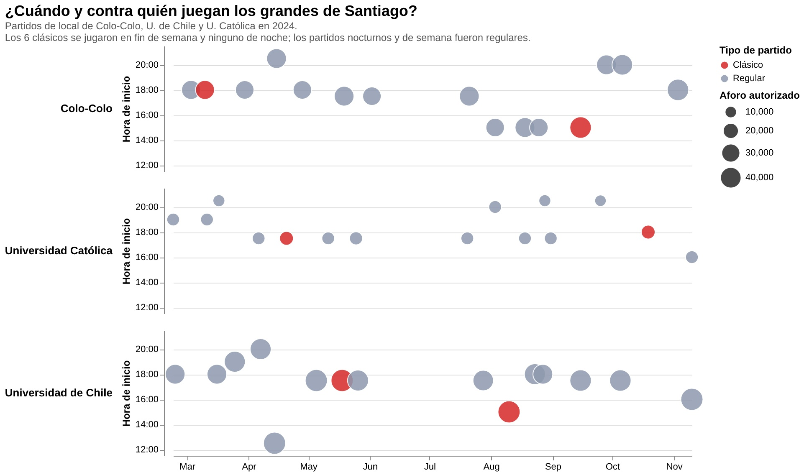

# ¿Cuándo y contra quién juegan los grandes de Santiago?

Cuando se habla de estadios con espacios vacíos en el fútbol chileno, la primera sospecha suele ser el precio de las entradas. Pero antes de llegar a esa discusión conviene mirar algo más básico: cuándo y contra quién se programan los partidos.

El gráfico reúne los 45 partidos que Colo-Colo, la Universidad de Chile y la Universidad Católica jugaron de local en 2024. Cada punto es un partido: su posición muestra la fecha y la hora de inicio, su tamaño el aforo autorizado, y su color distingue los clásicos (los duelos entre estos tres equipos) de los partidos regulares.

## Los clásicos tienen su propia ventana

Los seis clásicos del año se jugaron en fin de semana, entre las 15:00 y las 18:00. Ninguno fue de noche y ninguno cayó entre lunes y viernes. Es la ventana más habitual del campeonato: 37 de los 45 partidos fueron en sábado o domingo, y el horario más repetido fue las 17:30, con 16 partidos.

## La noche y la semana, para los demás

En el otro extremo, 11 partidos comenzaron a las 19:00 o más tarde y 8 se jugaron de lunes a viernes. Ningún clásico está entre ellos. De hecho, seis de los ocho partidos de semana fueron, además, de noche. Los rivales de esas jornadas fueron Cobreloa, Cobresal, Ñublense, Everton, Audax Italiano, Palestino, Unión Española y Deportes Copiapó.

## No todos cargan con lo mismo

La carga no se reparte por igual. La Católica jugó 6 de sus 15 partidos de local a las 19:00 o más tarde y 4 de ellos entre semana. Colo-Colo, en cambio, jugó 14 de 15 en fin de semana, 11 de ellos en domingo, y solo tres de noche. La U quedó en un punto intermedio: dos partidos nocturnos y tres entre semana.

## El aforo también cuenta algo

El tamaño de los puntos depende primero del estadio: el promedio autorizado fue de unas 40.800 personas en el Nacional, 34.100 en el Monumental y 12.200 en Santa Laura (la Católica jugó además un partido en La Florida, con 9.000).

Dentro de cada equipo, los clásicos tuvieron en promedio un aforo mayor que los partidos regulares: 45.000 contra 40.150 en la U, 15.000 contra 11.540 en la Católica y 37.000 contra 33.615 en Colo-Colo. Pero no siempre fue así. El clásico de Colo-Colo con la U de marzo tuvo un aforo de 32.000, por debajo del promedio de los partidos regulares en el Monumental.

## Lo que este gráfico todavía no dice

Esta visualización cuenta cómo se programa el fútbol, no cuánta gente va a verlo. Falta la pieza central: la asistencia real. Los datos se solicitaron mediante el portal de transparencia y aún no llegan, por lo que la ocupación de cada partido no se puede mostrar todavía.

Cuando estén, el mismo gráfico servirá para preguntar lo que importa: si los partidos con rival atractivo y horario de fin de semana por la tarde se llenan más que los de noche o de semana, y si esa diferencia pesa tanto como el precio de la entrada. Esa es la hipótesis del proyecto, y por ahora lo que muestran los datos es el escenario donde se juega: los clásicos tienen siempre la mejor ventana, y el resto del calendario carga con la noche y los días laborales.