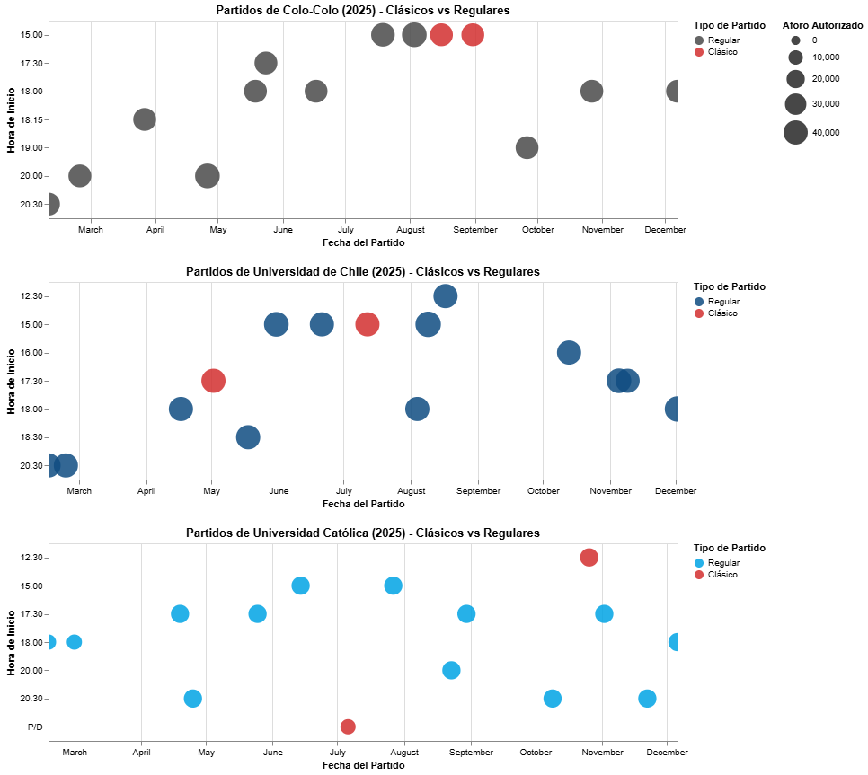

# Radiografía a la cancha: ¿cómo se programan los partidos en el fútbol chileno?

Cada vez que un estadio de fútbol luce desolado y con enormes sectores vacíos, la culpa suele recaer de inmediato sobre el mismo factor: los precios de las entradas. Sin embargo, antes de apuntar al bolsillo de los hinchas, vale la pena detenerse en la letra chica de la organización. ¿Cómo influyen realmente los horarios y los días elegidos en la presencia de público?

Para responder a esto, el gráfico reúne los encuentros disputados como local por Colo-Colo, la Universidad de Chile y la Universidad Católica. En esta visualización, cada círculo representa un partido: su ubicación en el plano indica el día y la hora de inicio, su diámetro refleja el aforo máximo permitido por la autoridad, y el color separa los duelos corrientes de los clásicos institucionales.

## Los privilegios del clásico
Al revisar la distribución de los partidos estelares, la tendencia salta a la vista. Los choques entre los tres grandes se disputan exclusivamente en días sábado o domingo, apostando por franjas vespertinas cómodas. Ninguno de estos encuentros de alta convocatoria se programa de noche ni cae entre lunes y viernes, resguardando así la asistencia y la logística operativa.

## Horarios ingratos para el resto
En la otra vereda se ubica el grueso del torneo. Los partidos programados en horarios nocturnos complejos o en pleno ciclo laboral semanal recaen de manera sistemática sobre los demás rivales de la categoría. Ningún clásico carga con la exigencia de un martes por la noche; esos bloques horarios quedan reservados para el resto de la cartelera.

## Desigualdades en la ruta de los clubes
La programación tampoco castiga de igual forma a los tres protagonistas. Mientras algunas instituciones logran concentrar casi toda su localía en los fines de semana tradicionales, otras deben lidiar con una rotación más pesada que incluye frecuentes duelos nocturnos o en días hábiles según la disponibilidad de sus recintos.

## El peso y los límites del aforo
Como es lógico, el tamaño de los círculos expone las diferencias estructurales entre estadios como el Nacional, el Monumental o San Carlos de Apoquindo. 

Si bien los clásicos lideran en cuanto a la capacidad autorizada, la norma no siempre se cumple a rajatabla. Las restricciones de seguridad y los operativos policiales provocan a menudo que partidos de enorme convocatoria terminen con aforos limitados que sorprenden por estar incluso por debajo de la media habitual.

## La pieza que falta en el tablero
Esta visualización expone con claridad el mapa de cómo se diseña la fecha a fecha, pero todavía no revela cuántas personas cruzaron los torniquetes. El eslabón que falta es la asistencia real, un dato solicitado mediante transparencia que todavía se encuentra en camino.

Una vez que esos registros estén disponibles, este mismo gráfico permitirá comprobar la gran interrogante del proyecto: si los partidos atractivos en fin de semana realmente superan en público a los de noche o de semana, y si esa brecha de asistencia pesa tanto como el valor del ticket. Por ahora, los datos dibujan con nitidez el escenario de fondo: la comodidad del calendario se la llevan los clásicos, mientras el resto del año carga con el peso de la noche y los días hábiles.